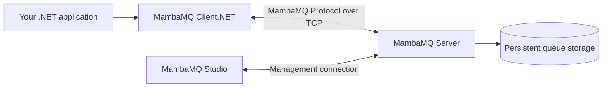

# MambaMQ

**A lightweight message broker built with .NET.** MambaMQ lets applications exchange messages through queues and exchanges, with a server, a .NET client library, a shared wire protocol, and a desktop management app.

> **Mamba + 8024** is a tribute to Kobe Bryant: both the project name and its default server port reference the legendary NBA player.

## At a glance



| Component | Purpose |
| --- | --- |
| **MambaMQ.Server** | Hosts queues and exchanges, accepts client connections, and stores messages. |
| **MambaMQ.Protocol** | Defines the messages and framing used for communication between clients and the server. |
| **MambaMQ.Client.NET** | .NET library for connecting to a server and working with queues, exchanges, and messages through `IMamba`. |
| **MambaMQ.Studio** | Desktop application for connecting to servers and managing them through a graphical interface. |

Applications register the client with `services.AddMamba(...)` and use the `IMamba` interface to create and manage queues and exchanges, publish messages, and consume messages. The client and Studio communicate with the server over the MambaMQ protocol using TCP (default port **24**).

### MambaMQ Studio

Studio is the desktop management interface. It supports saved connection profiles, multiple server connections, and a dashboard for connection status. From the app you can manage queues and exchanges, configure exchange bindings, inspect queue messages, and publish or delete messages.

**Studio has not been publicly released yet.** Once downloads are available, this section will link to the project's GitHub Releases page with versioned installers and portable builds where supported. Until then, there is no public Studio download to install.

## Use MambaMQ.Client.NET

After the first NuGet release, install the client package in your .NET project (replace the version with the release you need):

```bash
dotnet add package MambaMQ.Client.NET --version 0.1.1
```
Or you can download this repository and use this command:
```bash
dotnet add reference "<Enter_repository_path>/mamba-message-queue/sln/MambaMQ.Client.NET/MambaMQ.Client.NET.csproj"
```

Register the client in dependency injection and provide the server address, username and password:

```csharp
using MambaMQ.Client.NET;
using MambaMQ.Client.NET.Configure;

services.AddMamba(options =>
{
    options.Host = "localhost";
    options.Port = 8024;
    options.ServiceName = "orders-service"; // You can skip it if 'AuthorizationEnabled = false' on server
    options.Credentials.Username = Environment.GetEnvironmentVariable("USER_NAME")
        ?? throw new InvalidOperationException("USER_NAME is required.");
    options.Credentials.Password = Environment.GetEnvironmentVariable("PASSWORD")
        ?? throw new InvalidOperationException("PASSWORD is required.");
});
```

Inject `IMamba` into your application services to use the broker.
```bash
dotnet add package MambaMQ.Client.NET --version 0.1.1
```

Publisher example:
```csharp
using MambaMQ.Client.NET;
using MambaMQ.Client.NET.Options;

public class PublishToQueueExample(IMamba mamba)
{
    public async Task CreateQueueAsync()
    {
        await mamba.CreateQueueAsync(new QueueCreateOptions()
        {
            QueueName = "queue-name",
            IsDurable = false,
            LoadBalancingAlgorithm = LoadBalancingAlgorithm.LeastInFlight,
        });
    }
    
    public async Task PublishToQueueAsync()
    {
        await mamba.PublishToQueueAsync(
            "queue-name",
            new TestMessage
            {
                Message = "Some message here"
            });
    }
}

internal class TestMessage
{
    public required string Message { get; set; }
}
```
Message type by defauilt is generic type and you can use your own message structure.

Consumer example:
```csharp
using MambaMQ.Client.NET;
using MambaMQ.Protocol.Messages;

public class ConsumerExample(IMamba mamba)
{
    public async Task ProcessMessage(CancellationToken cancellationToken)
    {
        await foreach(MambaMessage message in mamba.SubscribeQueueAsync("queue-name")
        {
            //Your implementation
        }
    }
}
```

### MambaMQ Features:

MambaMQ provides a simple API for managing exchanges and queues, publishing and consuming messages, and controlling message lifecycle.
Exchanges
- Create exchanges — create a new exchange with the specified configuration.
- Get exchanges — retrieve all configured exchanges.
- Update exchanges — update an existing exchange.
- Delete exchanges — remove an exchange.
- Bind queues — bind a queue to an exchange using a routing key.
- Unbind queues — remove an existing queue binding.
- Publish to exchanges — publish messages to an exchange with a routing key.
  Queues
- Create queues — create queues with configurable durability, load-balancing strategy, permissions, and message retention.
- Get queues — retrieve all configured queues.
- Update queues — update an existing queue.
- Delete queues — remove a queue.
- Publish to queues — publish messages directly to a queue.
  Message Consumption
- Subscribe to queues — consume messages asynchronously using IAsyncEnumerable<MambaMessage>.
- Batch subscriptions — consume multiple messages at once using configurable batch options.
  Message Management
- Get messages — retrieve messages from a queue with pagination.
- Delete messages — delete a specific message or multiple messages by their IDs.

## Run the server with Docker

MambaMQ Server is available as a public Docker image on Docker Hub.

- **Docker Hub:** [gorinichvisuals/mambamq-server](https://hub.docker.com/r/gorinichvisuals/mambamq-server)
- **Current version:** `0.1.1`
- **Latest image:** `gorinichvisuals/mambamq-server:latest`

### Configuration

MambaMQ Server can be configured using environment variables. Create an `.env` file in the same directory as your Docker Compose file:

```dotenv
MambaServerOptions__Port=8024
MambaServerOptions__MaxMessageSizeInBytes=1048576
MambaServerOptions__AuthorizationEnabled=false

QueueStorageOptions__MessageCleanupEnabled=false
QueueStorageOptions__MessageSegmentSizeInBytes=16777216
QueueStorageOptions__MaxMessageSegments=2
QueueStorageOptions__CleanupMessageInterval=00:10:00

ServerLoggingOptions__MinimumLevel=Information
ServerLoggingOptions__ConsoleEnabled=true

AuthenticationOptions__Username=admin
AuthenticationOptions__Password=change-me
```

Replace the default authentication credentials with strong, unique values before starting the server. Do not commit your `.env` file to source control.

### Configuration options

**Networking**
- `MambaServerOptions__Port` — The port on which MambaMQ Server listens for client connections. Default: `8024`.
- `MambaServerOptions__MaxMessageSizeInBytes` — The maximum allowed message size in bytes. Messages exceeding this limit are rejected. Default: `1048576` (1 MiB).

**Authorization**
- `MambaServerOptions__AuthorizationEnabled` — Enables or disables service-level authorization. When enabled, permissions control which operations a service can perform on a queue. For example, one service can publish messages while another can read and delete them. When disabled, queue permission checks are bypassed.

**Queue storage**
- `QueueStorageOptions__Path` — The directory used to store persistent queue data. In Docker, use `/app/data`. Mount a persistent volume to preserve data across container recreation and upgrades.
- `QueueStorageOptions__MessageCleanupEnabled` — Enables or disables automatic message storage cleanup. When enabled, MambaMQ periodically removes eligible message segments. A segment can only be removed when it is no longer active and all messages in it have corresponding delete records.
- `QueueStorageOptions__MessageSegmentSizeInBytes` — The target maximum size of an individual message storage segment. When a segment reaches this size, storage continues in another segment.
- `QueueStorageOptions__MaxMessageSegments` — The target maximum number of message storage segments retained before cleanup becomes necessary. This is not a strict disk usage limit because active segments and segments containing undeleted messages must be preserved.
- `QueueStorageOptions__CleanupMessageInterval` — The interval between automatic message cleanup checks. Default example: `00:10:00` (10 minutes).

**Logging**
- `ServerLoggingOptions__MinimumLevel` — The minimum severity level written to the server console. Supported values include `Trace`, `Debug`, `Information`, `Warning`, `Error`, and `Critical`.
- `ServerLoggingOptions__ConsoleEnabled` — Enables or disables console logging.

**Authentication**
- `AuthenticationOptions__Username` — The username used to authenticate connections and sign in to MambaMQ Studio.
- `AuthenticationOptions__Password` — The password used to authenticate connections and sign in to MambaMQ Studio.

### Start with Docker Compose (recommended)

Download `docker-compose.release.yml` and `.env.example` from the repository.

Copy `.env.example` to `.env`:

```bash
cp .env.example .env
```

Edit `.env` and configure your credentials and other settings.

Start MambaMQ Server:

```bash
docker compose -f docker-compose.release.yml up -d
```

Docker Compose automatically pulls the published image from Docker Hub.

View server logs:

```bash
docker compose -f docker-compose.release.yml logs -f
```

Update to the latest published image:

```bash
docker compose -f docker-compose.release.yml pull
docker compose -f docker-compose.release.yml up -d
```

Stop the server:

```bash
docker compose -f docker-compose.release.yml down
```

Queue data is stored in a persistent Docker volume named `mambamq-data` and is preserved when the container is stopped, removed, or recreated.

**Warning:** Removing volumes with `docker compose down --volumes` permanently deletes the stored queue data. Back up your data before doing this.

### Run with Docker CLI

You can also run MambaMQ Server directly without Docker Compose.

Pull the image:

```bash
docker pull gorinichvisuals/mambamq-server:0.1.1
```

Run the container:

```bash
docker run -d \
  --name mambamq-server \
  --restart unless-stopped \
  -p 8024:8024 \
  --env-file .env \
  -v mambamq-data:/app/data \
  gorinichvisuals/mambamq-server:0.1.1
```

The `-p` option uses the `host-port:container-port` format. The container port must match `MambaServerOptions__Port`.

View logs:

```bash
docker logs -f mambamq-server
```

Stop the server:

```bash
docker stop mambamq-server
```

### Build and run from source

If you prefer to build MambaMQ Server yourself, clone the repository and run the following commands from its root directory.

Copy the example environment file:

```bash
cp .env.example .env
```

Configure your credentials in `.env`, then build and start the server:

```bash
docker compose up --build -d
```

View logs:

```bash
docker compose logs -f mambamq-server
```

Stop the server:

```bash
docker compose down
```

The `mambamq-data` volume is preserved when the service is stopped or removed.

### Publish a Docker image

To publish a new MambaMQ Server release, build the image with a version-specific tag and the `latest` tag:

```bash
docker login

docker build \
  -t gorinichvisuals/mambamq-server:0.1.1 \
  -t gorinichvisuals/mambamq-server:latest .

docker push gorinichvisuals/mambamq-server:0.1.1
docker push gorinichvisuals/mambamq-server:latest
```

Replace `0.1.0` with the version being released.

Each release should have its own version-specific tag. The `latest` tag should point to the most recently published release.
