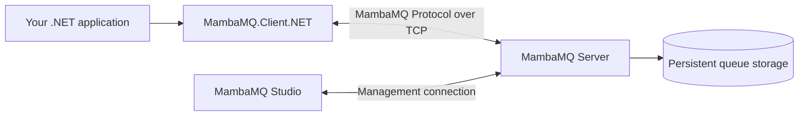

# MambaMQ

**A lightweight message broker built with .NET.** MambaMQ lets applications exchange messages through queues and exchanges, with a server, a .NET client library, a shared wire protocol, and a desktop management app.

> **Mamba + 24** is a tribute to Kobe Bryant: both the project name and its default server port reference the legendary NBA player.

## At a glance



| Component | Purpose |
| --- | --- |
| **MambaMQ.Server** | Hosts queues and exchanges, accepts client connections, and stores messages. |
| **MambaMQ.Protocol** | Defines the messages and framing used for communication between clients and the server. |
| **MambaMQ.Client.NET** | .NET library for connecting to a server and working with queues, exchanges, and messages through `IMamba`. |
| **MambaMQ.Studio** | Desktop application for connecting to servers and managing them through a graphical interface. |

Applications register the client with `services.AddMamba(...)` and use the `IMamba` interface to create and manage queues and exchanges, publish messages, and consume messages. The client and Studio communicate with the server over the MambaMQ protocol using TCP (default port **24**).

### MambaMQ Studio

Studio is the desktop management interface. It supports saved connection profiles, multiple server connections, and a dashboard for connection status. From the app you can manage queues and exchanges, configure exchange bindings, inspect queue messages, and publish or delete messages.

**Studio has not been publicly released yet.** Once downloads are available, this section will link to the project's GitHub Releases page with versioned installers and portable builds where supported. Until then, there is no public Studio download to install.

## Use MambaMQ.Client.NET

After the first NuGet release, install the client package in your .NET project (replace the version with the release you need):

```bash
dotnet add package MambaMQ.Client.NET --version 0.1.0
```

Register the client in dependency injection and provide the server address and server key:

```csharp
using MambaMQ.Client.NET;
using MambaMQ.Client.NET.Configure;

services.AddMamba(options =>
{
    options.Host = "localhost";
    options.Port = 24;
    options.ServiceName = "orders-service";
    options.Credentials.ServerKey = Environment.GetEnvironmentVariable("MAMBA_SERVER_KEY")
        ?? throw new InvalidOperationException("MAMBA_SERVER_KEY is required.");
});
```

Inject `IMamba` into your application services to use the broker. The NuGet package has **not been published yet**; the install command is shown as the intended usage after release.

## Run the server with Docker

### Public Docker image status

The Docker image is **not published to Docker Hub yet**. After the first public release, the image will be available as `docker.io/your-dockerhub-username/mambamq-server:0.1.0`. Replace `your-dockerhub-username` and the version with the publisher's Docker Hub namespace and a published tag. A public image can be pulled and managed from Docker Desktop or the command line.

### Configure and start a published image

Download or create an `.env` file containing the settings you need. Start with the repository's `.env.example`, copy it to `.env`, and set at least the management username, management password, and server key to non-empty values. Choose strong, unique secrets; do not commit `.env` to source control.

```dotenv
MAMBA_HOST_PORT=24
MambaServerOptions__Port=24
MambaServerOptions__MaxMessageSizeInBytes=1048576
MambaServerOptions__AuthorizationEnabled=false
MambaServerOptions__QueueStorage__Path=/app/data
MambaServerOptions__QueueStorage__MessageCleanupEnabled=false
MambaServerOptions__QueueStorage__MessageSegmentSizeInBytes=16777216
MambaServerOptions__QueueStorage__MaxMessageSegments=2
MambaServerOptions__QueueStorage__CleanupMessageInterval=00:10:00
MambaServerOptions__ServerLogging__MinimumLevel=Information
MambaServerOptions__ServerLogging__ConsoleEnabled=true
MambaServerOptions__Authentication__Username=admin
MambaServerOptions__Authentication__Password=replace-with-a-strong-password
MambaServerOptions__Authentication__ServerKey=replace-with-a-long-random-key
```

#### Configuration options

**Networking**
- `MAMBA_HOST_PORT` — The host port exposed by Docker. Map this port to the container's listening port to make the server accessible from outside the container.
- `MambaServerOptions__Port` — The port on which the MambaMQ server listens for client connections inside the container.
- `MambaServerOptions__MaxMessageSizeInBytes` — The maximum allowed message size in bytes. Messages exceeding this limit are rejected. The default value shown above is 1 MiB (1,048,576 bytes).

**Authorization**
- `MambaServerOptions__AuthorizationEnabled` — Enables or disables service-level authorization. When enabled, permissions control which operations a service can perform on a queue. For example, one service can be allowed to publish messages while another can read and delete messages without being allowed to publish new ones. Configure the appropriate queue permissions for each service identity. When disabled, queue permission checks are bypassed.

**Queue storage**
- `MambaServerOptions__QueueStorage__Path` — The directory used to store persistent queue data. In Docker, `/app/data` is the container path. Mount a persistent volume to this directory to preserve queue data across container recreation or upgrades.
- `MambaServerOptions__QueueStorage__MessageCleanupEnabled` — Enables or disables automatic message storage cleanup. When enabled, MambaMQ periodically checks message segments and removes eligible segments according to its cleanup rules. Cleanup does not simply delete the oldest messages: a segment can only be removed when it is no longer active and all messages in it have corresponding delete records. Keep this disabled if you do not want automatic cleanup.
- `MambaServerOptions__QueueStorage__MessageSegmentSizeInBytes` — The maximum target size of a message storage segment in bytes. Once a segment reaches this size, storage continues in another segment. Larger segments reduce the number of files but can increase the amount of data held in a single segment.
- `MambaServerOptions__QueueStorage__MaxMessageSegments` — The target maximum number of message storage segments retained before cleanup becomes necessary. For example, `2` configures MambaMQ to trigger cleanup when the number of segments exceeds two. This is not a strict disk usage limit: the active segment and segments containing messages that have not been deleted must be preserved. As a result, the actual number of segments can exceed this value.
- `MambaServerOptions__QueueStorage__CleanupMessageInterval` — The interval between automatic message cleanup checks. The example value, `00:10:00`, means cleanup runs every 10 minutes when message cleanup is enabled.

**Logging**
- `MambaServerOptions__ServerLogging__MinimumLevel` — The minimum severity level written to the server console. Common values are `Trace`, `Debug`, `Information`, `Warning`, `Error`, and `Critical`. Messages below the configured level are ignored.
- `MambaServerOptions__ServerLogging__ConsoleEnabled` — Enables or disables console logging. Set this to `true` to see server logs in the Docker container output.

**Authentication**
- `MambaServerOptions__Authentication__Username` — The username used to sign in to MambaMQ Studio.
- `MambaServerOptions__Authentication__Password` — The password used to sign in to MambaMQ Studio. Replace the example value with a strong password.
- `MambaServerOptions__Authentication__ServerKey` — The server key used by application clients to authenticate with MambaMQ. Replace the example value with a long, randomly generated secret.

The double underscores in `MambaServerOptions__...` map environment variables to nested .NET configuration settings.

**Important:** Authentication and authorization serve different purposes. Authentication verifies a client's credentials, while authorization determines which operations an authenticated service is allowed to perform. Enable `AuthorizationEnabled` when you need to restrict services to specific queue operations.

The management username and password are used when signing in to Studio. `ServerKey` is the credential for application clients. The double underscores in `MambaServerOptions__...` map environment variables to nested .NET configuration settings.

```bash
docker pull your-dockerhub-username/mambamq-server:0.1.0
docker run -d \
  --name mambamq-server \
  --restart unless-stopped \
  -p 24:24 \
  --env-file .env \
  -v mambamq-data:/app/data \
  your-dockerhub-username/mambamq-server:0.1.0
```

The `-p` value is `host-port:container-port`: the first `24` is where clients connect on your computer; the second is the port MambaMQ listens on inside the container. Keep the container port aligned with `MambaServerOptions__Port`. For example, to use host port `8080` while the container listens on `24`, use `-p 8080:24`. `MAMBA_HOST_PORT` is used by the included Compose setup; `docker run -p` sets the mapping directly.

The named volume keeps queue data across container replacement. View logs or stop the server with:

```bash
docker logs -f mambamq-server
docker stop mambamq-server
```

### Build and run from this repository

Until the public image is released, build the server locally with Docker Compose. From the repository root:

```powershell
Copy-Item .env.example .env
```

Edit `.env` and replace the empty authentication values, then start the server:

```bash
docker compose up --build -d
docker compose logs -f mambamq-server
```

Stop the Compose service with `docker compose down`. The `mambamq-data` volume remains so queue data is preserved; remove it only when you intentionally want to erase stored data:

```bash
docker compose down --volumes
```

## Publish the server image

When you are ready to publish, create a **public** Docker Hub repository named `mambamq-server`, sign in, then build and push a versioned image from the repository root:

```bash
docker login
docker build -t your-dockerhub-username/mambamq-server:0.1.0 .
docker push your-dockerhub-username/mambamq-server:0.1.0
```

The repository version is currently **0.1.0**. Publish a new immutable version tag for each release; optionally also tag that same image as `latest` for users who deliberately want the newest release. After publishing, replace the placeholders in the Docker install instructions with the real Docker Hub namespace and link the image page here.
